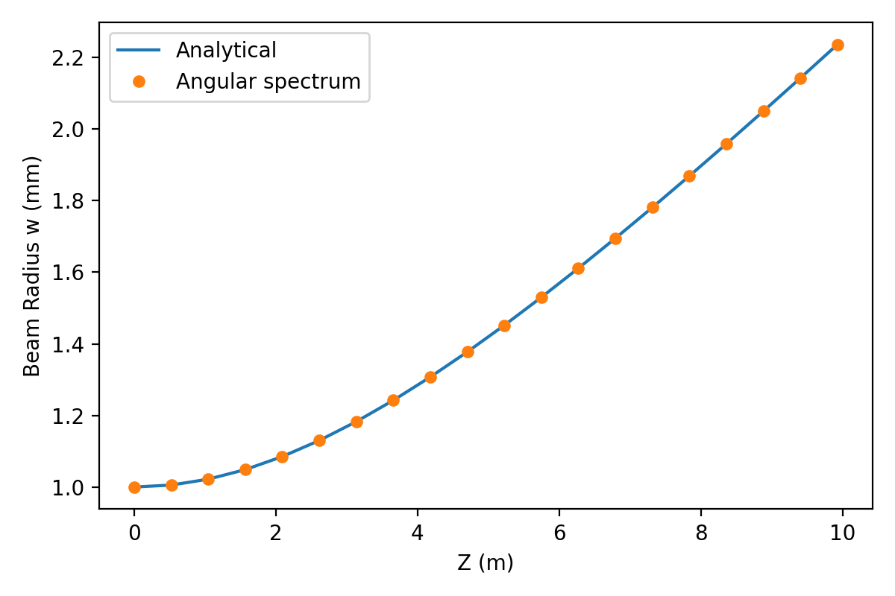
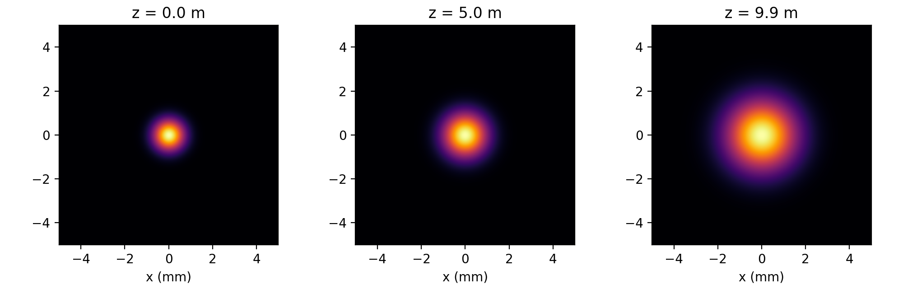

# Gaussian Beam Propagation (Angular Spectrum Method)

Numerical propagation of a Gaussian laser beam using the angular spectrum
method, validated against the analytical Gaussian-beam formula.

## Physics

The field in the plane z = 0 is decomposed into plane waves with a Fourier
transform. Each plane wave acquires a phase exp(i·kz·z), where
kz = sqrt(k² − kx² − ky²), and an inverse transform gives the field at
distance z. Evanescent waves (kx² + ky² > k²) are discarded.

For a Gaussian beam with waist w0, the analytical beam radius is

    w(z) = w0 · sqrt(1 + (z / zR)²),   zR = π·w0² / λ

## Results

Beam radius versus propagation distance. The simulation (markers) matches
the analytical curve (line):

Intensity profiles at z = 0, zR and 2·zR:

## Input parameters

| Code name | Symbol | Meaning | Value |
|-----------|--------|---------|-------|
| `wave_lgh` | λ | Wavelength (He-Ne laser) | 633 nm |
| `w0` | w₀ | Beam waist (1/e² intensity radius at z = 0) | 1 mm |
| `L` | L | Size of the computational window | 10 mm |
| `N` | N | Number of grid points per side | 1024 |

Derived quantities:

| Code name | Symbol | Formula | Value |
|-----------|--------|---------|-------|
| `rayleigh` | z_R | π·w₀² / λ | ≈ 4.96 m |
| `size / n` | Δx | L / N (grid spacing) | ≈ 9.8 µm |

## Variables in the code

| Code name | Symbol | Meaning |
|-----------|--------|---------|
| `u0` | u(x, y, 0) | Input field at z = 0 |
| `x`, `X`, `Y` | x, y | Spatial coordinates (1D axis and 2D grids) |
| `fx`, `FX`, `FY` | f_x, f_y | Spatial frequencies (kx = 2π·f_x, ky = 2π·f_y) |
| `arg` | kz² / k² | 1 − (λ·f_x)² − (λ·f_y)²; positive for propagating waves |
| `kz` | k_z | Longitudinal wave number, (2π/λ)·sqrt(arg) |
| `dil_phase` | H(f_x, f_y; z) | Transfer function exp(i·kz·z); zero for evanescent waves |
| `i` (in `propagate`) | z | Propagation distance |
| `z_point` | z | Array of 20 distances from 0 to 2·z_R |
| `w_num` | w_num(z) | Beam radius from the simulation |
| `w_z` | w(z) | Analytical beam radius |
| `Intensity` | I(x) | Intensity summed along y, |u|² |
| `sigma_dispersion` | σ² | Second moment of the intensity profile; w = 2σ |

## Usage

    pip install -r requirements.txt
    python src/BEAM.py

The script saves `figures/beam_width.png` and `figures/beam_profiles.png`.